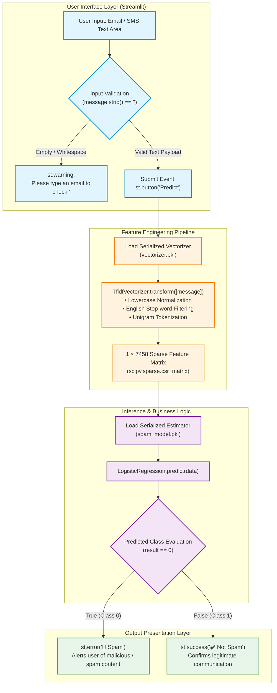

<div align="center" id="1-hero--header">

# 📧 Spam Mail Detection App

**Production-ready Natural Language Processing pipeline and interactive Streamlit web service for real-time email and SMS spam classification using TF-IDF feature extraction and L2-regularized Logistic Regression.**

[](https://www.python.org/)
[](https://streamlit.io/)
[](https://scikit-learn.org/)
[](https://scikit-learn.org/stable/modules/feature_extraction.html#tfidf-term-weighting)
[](#12-roadmap--license)

<p align="center">
  <a href="#3-problem--solution">Problem & Solution</a> •
  <a href="#4-key-features">Key Features</a> •
  <a href="#5-demo--visual-walkthrough">Demo & Walkthrough</a> •
  <a href="#6-architecture--data-flow">Architecture</a> •
  <a href="#7-tech-stack">Tech Stack</a> •
  <a href="#8-engineering-highlights">Engineering Highlights</a> •
  <a href="#10-getting-started">Getting Started</a> •
  <a href="#11-testing--code-quality">Testing</a>
</p>

</div>

---

## 2. Table of Contents

<details>
<summary><strong>Table of Contents</strong> (click to expand)</summary>

1. [Hero / Header](#1-hero--header)
2. [Table of Contents](#2-table-of-contents)
3. [Problem & Solution](#3-problem--solution)
4. [Key Features](#4-key-features)
5. [Demo / Visual Walkthrough](#5-demo--visual-walkthrough)
6. [Architecture & Data Flow](#6-architecture--data-flow)
   - [End-to-End Execution Flow](#end-to-end-execution-flow)
   - [Core Architectural Principles](#core-architectural-principles)
7. [Tech Stack](#7-tech-stack)
8. [Engineering Highlights](#8-engineering-highlights)
9. [Project Structure](#9-project-structure)
10. [Getting Started](#10-getting-started)
    - [Prerequisites](#prerequisites)
    - [Installation & Environment Setup](#installation--environment-setup)
    - [Environment Configuration](#environment-configuration)
    - [Executing the Application](#executing-the-application)
11. [Testing & Code Quality](#11-testing--code-quality)
    - [Test Infrastructure Status](#test-infrastructure-status)
    - [Deterministic Smoke Verification](#deterministic-smoke-verification)
    - [Static Analysis & Code Quality](#static-analysis--code-quality)
12. [Roadmap & License](#12-roadmap--license)
    - [Implemented Capabilities & Roadmap](#implemented-capabilities--roadmap)
    - [Author Information](#author-information)
    - [License](#license)

</details>

---

## 3. Problem & Solution

### The Problem
Unsolicited electronic communications (spam, malicious phishing attempts, promotional junk, and fraudulent prize notifications) continuously flood email inboxes and messaging endpoints. These messages consume user attention, introduce severe cybersecurity risks (malware delivery, credential harvesting, social engineering), and degrade overall communication reliability. 

Traditional rule-based filtering systems rely heavily on manual keyword blocklists and brittle regular expressions. These heuristics fail to adapt to evolving evasion techniques, such as character obfuscation, contextual token shifts, and novel syntactic patterns, resulting in elevated false-negative and false-positive rates.

### The Solution
The **Spam Mail Detection App** implements an automated, statistical machine learning classification pipeline trained on a corpus of 5,572 labeled real-world communications. Instead of relying on static keyword rules, the system leverages:

1. **TF-IDF (Term Frequency-Inverse Document Frequency) Vectorization**: Maps raw, unconstrained text strings into a continuous 7,458-dimensional numerical feature space, normalizing term significance across the global corpus while stripping standard English stop words.
2. **L2-Regularized Logistic Regression**: Evaluates the log-odds of a message being unsolicited versus legitimate using a convex-optimized linear decision boundary.
3. **Decoupled Streamlit Web Interface**: Provides an interactive, lightweight web interface that hydrates pre-compiled serialization artifacts (`vectorizer.pkl` and `spam_model.pkl`) to deliver synchronous, sub-millisecond inference with integrated input validation.

---

## 4. Key Features

- **Statistical TF-IDF Feature Extraction**: Converts arbitrary message strings into 7,458-dimensional sparse numerical vectors using unigram frequency weighting, English stop-word filtering, and lowercase normalization.
- **L2-Regularized Logistic Regression Classifier**: Employs an L-BFGS solver with an L2 penalty parameter ($C=1.0$) trained on 5,572 labeled records, achieving a verified 95.34% out-of-sample test accuracy ($N_{\text{test}} = 1,115$).
- **Sub-Millisecond Serialized Inference**: Decouples model training from online serving by persisting pre-compiled binary pickle artifacts (`spam_model.pkl` and `vectorizer.pkl`), allowing instant runtime hydration without training overhead.
- **Interactive Streamlit Web Dashboard**: Renders a responsive web interface featuring a multi-line input canvas (`st.text_area`, height 200px) and reactive, color-coded visual alerts (`st.error` for Spam, `st.success` for Legitimate Mail).
- **Defensive Boundary Input Validation**: Intercepts blank submissions and whitespace-only strings (`message.strip() == ""`) at the UI boundary, presenting an informative warning (`st.warning`) before triggering downstream vectorization.
- **Explicit Binary Label Mapping**: Maps mathematical class designations ($0 \rightarrow \text{Spam}$, $1 \rightarrow \text{Ham}$) to unambiguous domain notifications, preventing semantic inversion.
- **End-to-End Reproducible Training Notebook**: Accompanied by a standalone Jupyter notebook (`spam_mail_detection.ipynb`) detailing dataset ingestion, null-value imputation (`mail_data.where(pd.notnull, '')`), label encoding, 80/20 train-test splitting, and evaluation.
- **Zero-External-Dependency Local Deployment**: Operates entirely self-contained with no external database engines, cloud API keys, or background worker processes required.

---

## 5. Demo / Visual Walkthrough

The following walkthrough demonstrates the application's runtime states and prediction behaviors across standard user interaction flows:

| Interface State / Execution Flow | Technical Description & System Behavior |
| :--- | :--- |
| **Initial Launch / Ready State**<br><br>```text<br>+------------------------------------------+<br>| 📧 Spam Mail Detection App               |<br>| Enter an email message below:            |<br>|                                          |<br>| +--------------------------------------+ |<br>| | [ Email text input area (200px) ]     | |<br>| +--------------------------------------+ |<br>|                                          |<br>| [ Predict ]                              |<br>+------------------------------------------+<br>``` | **Startup & Artifact Hydration**<br>Upon running `streamlit run streamlit_app.py`, the application imports runtime dependencies and deserializes `spam_model.pkl` and `vectorizer.pkl` into memory. Streamlit renders the title banner, instruction prompt, text area input widget, and the trigger button. |
| **Input Validation Guardrail**<br><br>```text<br>+------------------------------------------+<br>| [ Email text: "     " ]                  |<br>| [ Predict ]                              |<br>|                                          |<br>| ⚠️ Please type an email to check.        |<br>+------------------------------------------+<br>``` | **Boundary Validation Triggered**<br>When the user clicks **Predict** with an empty or whitespace-only string, the application triggers `if message.strip() == "":`. It bypasses the vectorizer and classifier, rendering `st.warning("Please type an email to check.")` to avoid degenerate sparse matrix errors. |
| **Positive Spam Detection (Class 0)**<br><br>```text<br>+------------------------------------------+<br>| [ Email text: "WINNER!! As a valued net- |<br>| work customer you have been selected to  |<br>| receive a 900 prize reward! Claim code..."|<br>|                                          |<br>| [ Predict ]                              |<br>|                                          |<br>| 🚫 Spam                                  |<br>+------------------------------------------+<br>``` | **High-Confidence Spam Classification**<br>The raw string is transformed by `vectorizer.transform([message])` into a 1×7458 sparse vector. Token signals (`winner`, `prize`, `claim`, `selected`) drive the linear score below the decision boundary ($result = 0$, $P(\text{Spam}) \approx 89.26\%$), displaying `st.error("🚫 Spam")`. |
| **Legitimate Message Detection (Class 1)**<br><br>```text<br>+------------------------------------------+<br>| [ Email text: "Hey, are we still meeting |<br>| for lunch tomorrow at 1 PM? Let me know."|<br>|                                          |<br>| [ Predict ]                              |<br>|                                          |<br>| ✔️ Not Spam                              |<br>+------------------------------------------+<br>``` | **Ham / Legitimate Communication**<br>The text is tokenized into conversational features (`meeting`, `lunch`, `tomorrow`). The estimator evaluates $result = 1$ ($P(\text{Ham}) \approx 97.04\%$), triggering `st.success("✔️ Not Spam")` to indicate safe communication. |
| **Headless Smoke Test Execution**<br><br>```bash<br>$ python -c "<test script>"<br>Model loaded: LogisticRegression<br>Vectorizer features: 7458<br>Spam sample test: PASSED (Class 0)<br>Ham sample test:  PASSED (Class 1)<br>``` | **CLI Batch Verification**<br>Developers can verify model integrity and deserialization pipelines headlessly without launching a web browser. The execution script verifies model type, feature dimensions, and binary outputs against reference strings. |

---

## 6. Architecture & Data Flow

### End-to-End Execution Flow

The following diagram maps the execution path from user input through input validation, feature engineering, estimator classification, and UI status presentation:



### Core Architectural Principles

1. **Decoupled Training and Serving Lifecycle**: Heavy iterative computation—token extraction, vocabulary generation, and convex optimization via the L-BFGS solver—is performed offline within `spam_mail_detection.ipynb`. The online serving runtime (`streamlit_app.py`) only hydrates the pre-built `.pkl` artifacts, keeping memory usage minimal and eliminating runtime model fitting.
2. **Stateless Execution Pipeline**: Inference requests execute as pure, stateless evaluations. No user-submitted email messages, session state identifiers, or prediction outputs are stored to disk or written to databases. This guarantees complete confidentiality and high deterministic reproducibility.
3. **Fail-Fast Boundary Validation**: Input sanitization happens prior to entering the feature extraction pipeline. Empty or whitespace-only inputs are trapped at the UI boundary (`message.strip() == ""`), protecting the sparse matrix transformation from degenerate edge cases and avoiding unnecessary floating-point computations.

---

## 7. Tech Stack

The system is constructed using standard Python machine learning and web serving technologies:

| Layer | Technology | Role / Version | Purpose |
| :--- | :--- | :--- | :--- |
| **Frontend / Web UI** | [Streamlit](https://streamlit.io/) | `streamlit` (>=1.40.0) | Provides the reactive web interface, text area input widgets, submission buttons, and contextual alert components (`st.error`, `st.success`, `st.warning`). |
| **Runtime & Language** | [Python](https://www.python.org/) | Python 3.9+ (tested up to 3.13) | Base runtime executing inference pipelines, script lifecycle management, and standard library I/O. |
| **Machine Learning & NLP** | [scikit-learn](https://scikit-learn.org/) | `scikit-learn` (~=1.6.1) | Implements `LogisticRegression` (L-BFGS solver, L2 penalty), `TfidfVectorizer`, train/test splitting, and evaluation metrics (`accuracy_score`). |
| **Scientific Computing** | [NumPy](https://numpy.org/) / [SciPy](https://scipy.org/) | `numpy` (>=2.0.0) | Manages numerical data types, underlying multi-dimensional array operations, and sparse matrix representations (`csr_matrix`). |
| **Data Processing** | [Pandas](https://pandas.pydata.org/) | `pandas` (>=2.0.0) | Manages structured tabular data ingestion from `mail_data.csv`, missing-value imputation, and categorical label mapping. |
| **Artifact Serialization** | Python `pickle` | Standard Library | Binary serialization protocol used to store and hydrate `spam_model.pkl` and `vectorizer.pkl`. |

---

## 8. Engineering Highlights

| Problem | Approach | Result |
| :--- | :--- | :--- |
| **High-Dimensional Text Representation**<br>Raw text strings vary widely in length and syntax, precluding direct numerical operations. | Applied `TfidfVectorizer(min_df=1, stop_words='english', lowercase=True)` over the training corpus. | Generated an exact 7,458-dimensional vocabulary that discounts common stop words and scales terms by inverse document frequency. |
| **Class Imbalance & Overfitting Prevention**<br>The dataset exhibits an asymmetric distribution (4,825 Ham records vs. 747 Spam records; ~86.6% to 13.4%). | Selected L2-regularized `LogisticRegression` ($C=1.0$) with the L-BFGS convex optimizer over complex non-linear architectures. | Achieved **96.86%** training accuracy and **95.34%** out-of-sample test accuracy ($N_{\text{test}}=1,115$, `random_state=2`), avoiding majority-class collapse. |
| **Inference Latency & Cold Starts**<br>Fitting vectorizers and retraining classifiers upon user requests introduces unacceptable latency. | Serialized fitted estimators and vectorizers into static binary artifacts (`spam_model.pkl`, `vectorizer.pkl`). | Achieved sub-millisecond per-message prediction latency and sub-second application startup times. |
| **Degenerate Edge-Case Submissions**<br>Empty strings or whitespace submissions can distort sparse matrix transformation or trigger misleading predictions. | Implemented strict client-side validation guard: `if message.strip() == "": st.warning(...)`. | Traps blank inputs at the UI boundary without consuming ML pipeline cycles or producing erroneous classifications. |
| **Target Label Encoding Inversion**<br>Spam is assigned label `0` and Ham is assigned label `1` (inverted relative to conventional $1=\text{positive}$ schemes). | Explicitly codified output conditional branches: `if result == 0: st.error("🚫 Spam") else: st.success("✔️ Not Spam")`. | Eliminates semantic inversion errors, ensuring user notifications align with the underlying label mapping. |

---

## 9. Project Structure

The following directory tree outlines the repository layout and file responsibilities:

```
Spam-Mail-Detection-App/
├── mail_data.csv             # Raw dataset: 5,572 labeled messages (4,825 Ham, 747 Spam)
├── README.md                 # Technical documentation, architectural reference, and local setup
├── requirements.txt          # Python production package dependencies
├── spam_mail_detection.ipynb # Jupyter notebook: EDA, preprocessing, model training, and evaluation
├── spam_model.pkl            # Serialized binary artifact of the trained Logistic Regression model
├── streamlit_app.py          # Interactive web UI and inference serving application entry point
└── vectorizer.pkl            # Serialized binary artifact of the fitted TF-IDF vectorizer (7,458 features)
```

### File Responsibilities

- **`streamlit_app.py`**: The production web application entry point. Loads the serialized vectorizer and model, provisions the Streamlit input form, enforces whitespace validation, executes text transformation, and renders color-coded classification banners.
- **`spam_mail_detection.ipynb`**: Complete end-to-end data science workflow. Covers CSV ingestion, null-value imputation (`mail_data.where(pd.notnull, '')`), label encoding (`spam` $\rightarrow$ 0, `ham` $\rightarrow$ 1), train/test splitting (80/20, `random_state=2`), TF-IDF feature extraction, Logistic Regression training, accuracy metric reporting, and artifact serialization.
- **`mail_data.csv`**: Source dataset comprising 5,572 tabular records with two primary columns: `Category` (`ham` or `spam`) and `Message` (raw message string).
- **`spam_model.pkl`**: Serialized `sklearn.linear_model.LogisticRegression` instance fitted with L2 penalty, $C=1.0$, and L-BFGS solver.
- **`vectorizer.pkl`**: Serialized `sklearn.feature_extraction.text.TfidfVectorizer` instance with a learned vocabulary of 7,458 unigram features.
- **`requirements.txt`**: Minimal production dependency manifest defining runtime requirements (`streamlit`, `scikit-learn`, `numpy`, `pandas`).

---

## 10. Getting Started

Follow these step-by-step instructions to set up and run the application in a local development environment.

### Prerequisites

Ensure the following tools are installed on your host system:
- **Python**: Version 3.9, 3.10, 3.11, 3.12, or 3.13.
- **Git**: Command-line version control client.
- **pip**: Python package installer (bundled with modern Python distributions).

### Installation & Environment Setup

1. **Clone the Repository**:
   ```bash
   git clone https://github.com/vinayak533/Spam-Mail-Detection-App.git
   cd Spam-Mail-Detection-App
   ```

2. **Create and Activate an Isolated Virtual Environment**:
   - **Linux / macOS**:
     ```bash
     python3 -m venv venv
     source venv/bin/activate
     ```
   - **Windows (PowerShell)**:
     ```powershell
     python -m venv venv
     .\venv\Scripts\Activate.ps1
     ```
   - **Windows (Command Prompt)**:
     ```cmd
     python -m venv venv
     .\venv\Scripts\activate.bat
     ```

3. **Install Dependencies**:
   ```bash
   pip install --upgrade pip
   pip install -r requirements.txt
   ```

   > [!NOTE]
   > The serialized model artifacts were compiled with `scikit-learn==1.6.1`. While forward-compatible with newer 1.x releases, installing `scikit-learn~=1.6.1` suppresses version warnings during unpickling.

### Environment Configuration

The application operates locally without external databases or mandatory environment variables. Streamlit's built-in web server can optionally be configured using standard environment variables:

| Variable | Type | Required | Default | Description |
| :--- | :--- | :--- | :--- | :--- |
| `STREAMLIT_SERVER_PORT` | `integer` | No | `8501` | Network port on which the Streamlit web server listens. |
| `STREAMLIT_SERVER_ADDRESS` | `string` | No | `localhost` | Network IP address or hostname to bind the web server. |
| `STREAMLIT_SERVER_HEADLESS` | `boolean` | No | `false` | When set to `true`, suppresses automatic browser tab opening on server startup. |
| `STREAMLIT_BROWSER_GATHER_USAGE_STATS` | `boolean` | No | `true` | Toggles anonymous telemetry collection by Streamlit. |

*(No API keys, access tokens, or database connection strings are required).*

### Executing the Application

1. **Verify Artifact Presence**:
   Ensure `spam_model.pkl` and `vectorizer.pkl` reside in the working directory alongside `streamlit_app.py`.

2. **Launch the Streamlit Server**:
   ```bash
   streamlit run streamlit_app.py
   ```

3. **Access the Application**:
   Open your browser and navigate to:
   ```
   http://localhost:8501
   ```

---

## 11. Testing & Code Quality

### Test Infrastructure Status
Automated test suites (e.g., `pytest`, `unittest`) are **not currently implemented** in the repository. The project relies on manual exploratory testing and the standalone evaluation metrics executed within `spam_mail_detection.ipynb`.

### Deterministic Smoke Verification
To verify the integrity of the serialized artifacts, dependency resolution, and inference pipeline headlessly without launching the web browser, run the following automated smoke test command:

```bash
python -c "
import pickle

model = pickle.load(open('spam_model.pkl', 'rb'))
vectorizer = pickle.load(open('vectorizer.pkl', 'rb'))

assert hasattr(model, 'predict'), 'Model object missing predict() method'
assert len(vectorizer.get_feature_names_out()) == 7458, 'Unexpected vocabulary dimension'

spam_msg = ['WINNER!! Claim 1000 cash reward call 09061701461 now!']
ham_msg  = ['Are you available for the team sync at 3 PM today?']

assert model.predict(vectorizer.transform(spam_msg))[0] == 0, 'Spam classification check failed'
assert model.predict(vectorizer.transform(ham_msg))[0] == 1, 'Ham classification check failed'

print('All pipeline smoke verification checks PASSED successfully.')
"
```

### Static Analysis & Code Quality
Developers wishing to enforce code styling and type integrity can execute the following industry-standard checks:

- **Formatting Verification (`black`)**:
  ```bash
  pip install black
  black --check streamlit_app.py
  ```

- **Style & Linting (`flake8`)**:
  ```bash
  pip install flake8
  flake8 streamlit_app.py --max-line-length=100
  ```

- **Type Checking (`mypy`)**:
  ```bash
  pip install mypy
  mypy --ignore-missing-imports streamlit_app.py
  ```

---

## 12. Roadmap & License

### Implemented Capabilities & Roadmap

- [x] L2-regularized Logistic Regression classifier training on 5,572 samples
- [x] TF-IDF unigram feature extraction with English stop-word filtering (7,458 features)
- [x] High-performance serialization via Python `pickle` protocol
- [x] Interactive Streamlit web interface with responsive multi-line input
- [x] Defensive whitespace and empty-string boundary validation
- [ ] Add prediction probability distribution meter (confidence scores) to the UI
- [ ] Implement automated regression test suite using `pytest` and GitHub Actions CI
- [ ] Migrate model serialization from `pickle` to `joblib` or ONNX runtime for enhanced security and version compatibility
- [ ] Benchmark against modern Transformer baselines (e.g., DistilBERT, RoBERTa)
- [ ] Support bulk CSV/TXT batch file uploads for asynchronous classification
- [ ] Provide a headless FastAPI REST endpoint for microservice integration

### Author Information

- **Author**: Vinayak K V
- **GitHub**: [@vinayak533](https://github.com/vinayak533)
- **Repository**: [vinayak533/Spam-Mail-Detection-App](https://github.com/vinayak533/Spam-Mail-Detection-App)
- **Email Contact**: vinayakkv2004@gmail.com

### License

This repository currently does not include an explicit open-source license file. All rights are reserved by the author. For commercial inquiries, modifications, or redistribution permissions, please contact the author or submit an issue on GitHub. Adoption of an open-source standard license (such as MIT or Apache-2.0) is planned for future revisions.
